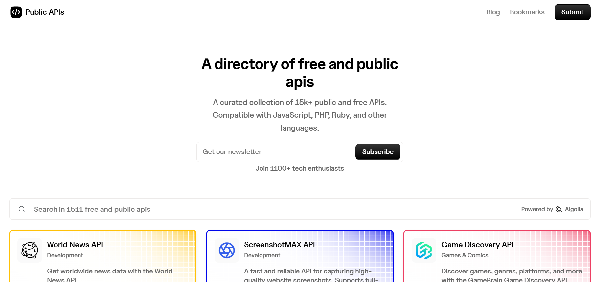

# Public Api's 
- Es una pagina que es esencial para ver las apis publicas que hay para futuros proyectos
- Comparible con distintos lenguajes como JavaScript, PHP, Python etc. 

---
puedes buscar y mostrar con pequeños ejemplos de como se consume y te redirije a la la pagina de la api para saber toda la informacion real 

## URL
 https://publicapis.io/ 

### Uso 
Revisa google calendar para lo que quieres hacer de la barberia. Revisalo bien 
URL: https://publicapis.io/google-calendar-api
